<picture><source media="(prefers-color-scheme: dark)" srcset="assets/intro-dark.svg"></picture>
<a href="https://strawberrycrew.com"><picture><source media="(prefers-color-scheme: dark)" srcset="assets/lien-strawberry-dark.svg"></picture></a><a href="https://www.instagram.com/nicolasdellimuti/"><picture><source media="(prefers-color-scheme: dark)" srcset="assets/lien-instagram-dark.svg"></picture></a><a href="https://vision-studio.be"><picture><source media="(prefers-color-scheme: dark)" srcset="assets/lien-studio-dark.svg"></picture></a>
<picture><source media="(prefers-color-scheme: dark)" srcset="https://raw.githubusercontent.com/Nicolasdellim/Nicolasdellim/output/activite-dark.svg"></picture>
