<picture>
  <source media="(prefers-color-scheme: dark)" srcset="assets/hero-dark.svg">
  
</picture>

  <a href="https://vision-studio.be"><picture><source media="(prefers-color-scheme: dark)" srcset="assets/link-site-dark.svg"></picture></a>
  &nbsp;
  <a href="https://www.instagram.com/nicolasdellimuti/"><picture><source media="(prefers-color-scheme: dark)" srcset="assets/link-instagram-dark.svg"></picture></a>
  &nbsp;
  <a href="mailto:EMAIL_A_DEFINIR"><picture><source media="(prefers-color-scheme: dark)" srcset="assets/link-email-dark.svg"></picture></a>

 

<picture>
  <source media="(prefers-color-scheme: dark)" srcset="assets/stack-dark.svg">
  
</picture>

 

<picture>
  <source media="(prefers-color-scheme: dark)" srcset="https://raw.githubusercontent.com/Nicolasdellim/Nicolasdellim/output/activity-dark.svg">
  
</picture>

Illustrations générées en SVG par <a href="scripts">scripts/</a> · Mons, Belgique

