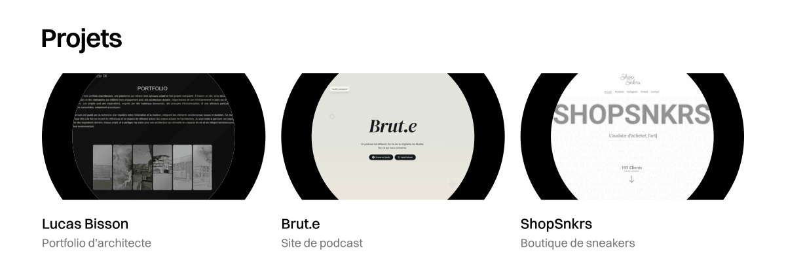
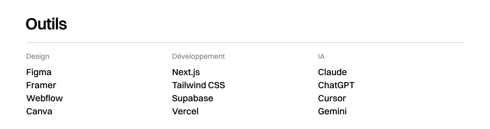
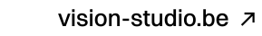

<picture>
  <source media="(prefers-color-scheme: dark)" srcset="assets/hero-dark.svg">
  
</picture>

 

<picture>
  <source media="(prefers-color-scheme: dark)" srcset="assets/projets-dark.svg">
  
</picture>

 

<picture>
  <source media="(prefers-color-scheme: dark)" srcset="assets/outils-dark.svg">
  
</picture>

 

<a href="https://vision-studio.be"><picture><source media="(prefers-color-scheme: dark)" srcset="assets/lien-site-dark.svg"></picture></a>
&nbsp;&nbsp;&nbsp;
<a href="https://www.instagram.com/nicolasdellimuti/"><picture><source media="(prefers-color-scheme: dark)" srcset="assets/lien-instagram-dark.svg"></picture></a>
